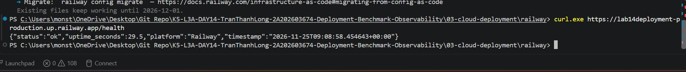
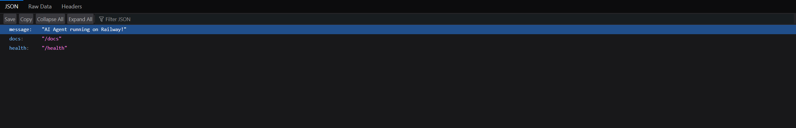
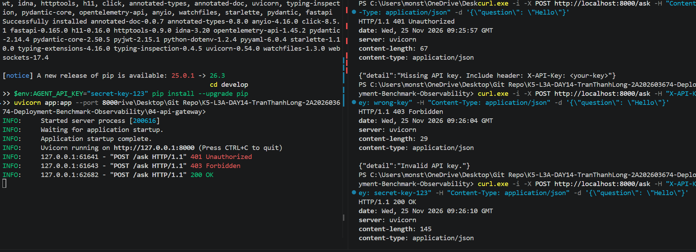
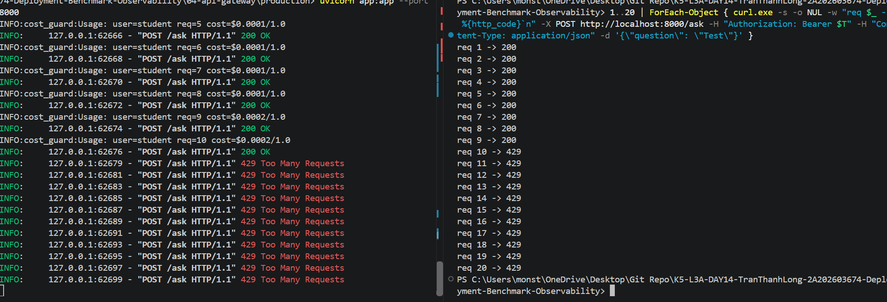

#  Delivery Checklist — Day 14 Lab Submission

> **Student Name:** __________Trần Thanh Long_______________  
> **Student ID:** ___________2A202603674______________  
> **Date:** ____________25/11/2026_____________

---

##  Submission Requirements

Submit a **GitHub repository** containing:

### 1. Mission Answers (40 points)

Create a file `MISSION_ANSWERS.md` with your answers to all exercises:

# Day 14 Lab - Mission Answers

## Part 1: Localhost vs Production

### Exercise 1.1: Anti-patterns found

| # | Anti-pattern | Dòng | Vì sao nguy hiểm |
|---|---|---|---|
| 1 | API key hardcode: `OPENAI_API_KEY = "sk-..."` | 17 | Push lên GitHub là key bị lộ ngay. Key nên được đọc từ biến môi trường. |
| 2 | Mật khẩu database hardcode trong `DATABASE_URL` | 18 | Cùng rủi ro lộ thông tin, và chỉ chạy được trên một máy. |
| 3 | Secret bị in ra log: `print(f"... {OPENAI_API_KEY}")` | 34 | Ai đọc được log là có key. |
| 4 | Bật debug cứng: `DEBUG = True` | 21 | Debug output trên production lộ chi tiết nội bộ, và không đổi được theo môi trường. |
| 5 | Không có quản lý config: `MAX_TOKENS = 500` hardcode | 22 | Đổi một giá trị phải sửa code và deploy lại. |
| 6 | Host và port cố định: `host="localhost"`, `port=8000` | 51–52 | `localhost` chỉ nhận kết nối từ chính máy đó, nên không chạy được trong container. Port cố định bỏ qua biến `PORT` mà Railway và Render cấp. |
| 7 | Bật auto-reload: `reload=True` | 53 | Reload chỉ dành cho lúc phát triển. Nó tốn tài nguyên và có thể khởi động lại server bất ngờ. |
| 8 | Dùng `print()` thay vì structured logging | 33, 34, 38 | Không có log level, không có timestamp, và không có cấu trúc JSON để công cụ log đọc được. |
| 9 | Không có health check endpoint | 42–43 | Platform không biết app còn sống hay không, nên không restart được instance bị treo. |
| 10 | Không có graceful shutdown | (không có handler) | Khi nhận SIGTERM, process dừng ngay, có thể làm đứt các request đang chạy. |

### Exercise 1.3: Comparison table

| Feature | Develop | Production | Why Important? |
|---|---|---|---|
| Config | Giá trị hardcode trong `app.py` (dòng 17–22) | Đọc từ biến môi trường trong `config.py` (`HOST`, `PORT`, `DEBUG`, `OPENAI_API_KEY`, `AGENT_API_KEY`…). `Settings.validate()` báo lỗi trên production nếu thiếu `AGENT_API_KEY`. | Cùng một image có thể chạy ở development, staging và production với giá trị khác nhau, và secret không nằm trong code. |
| Health check | Không có | `GET /health` (liveness: "process còn sống không?") và `GET /ready` (readiness: "đã nhận traffic được chưa?", trả 503 cho đến khi khởi động xong) | Platform dùng hai endpoint này để restart instance đã chết và tránh gửi traffic vào instance đang khởi động. |
| Logging | `print()`, secret nằm trong output | `logging` với format kiểu JSON; app log các sự kiện (`agent_request`, `agent_response`) và không log key | Công cụ log có thể tìm kiếm và cảnh báo theo field có cấu trúc. Secret trong log là lộ thông tin. |
| Shutdown | Đột ngột: process dừng, không dọn dẹp | Handler `lifespan` log lúc tắt, đặt `is_ready = False`, và chờ một chút cho request đang chạy; có đăng ký handler SIGTERM | Khi tắt instance lúc deploy, không nên làm đứt các request đang xử lý. |

**Những giới hạn tôi nhận thấy ở bản advanced (để thảo luận):**

- Handler SIGTERM (`handle_sigterm`) chỉ ghi log. Uvicorn mới là nơi thực hiện việc tắt, nên handler không thêm logic dọn dẹp nào.
- Thời gian chờ khi tắt là `time.sleep(0.1)` cố định, không phải chờ thật các request đang chạy.
- Phần khởi động có `time.sleep(0.1)` để giả lập việc load, đây là phần giữ chỗ.

Nên nêu các điểm này khi trả lời phần thảo luận, vì tên gọi "graceful shutdown" trong code mạnh hơn những gì code thực sự làm.

## Part 2: Docker

### Exercise 2.1: Dockerfile questions (`02-docker/develop/Dockerfile`)
1. **Base image:** `python:3.11` bản Python đầy đủ (khoảng 1 GB), có sẵn nhiều công cụ build không cần khi chạy.
2. **Working directory:** `/app` (đặt bằng `WORKDIR /app`). Các lệnh `COPY`, `RUN`, `CMD` sau đó đều chạy trong thư mục này.
3. **Tại sao COPY requirements.txt trước:** Docker cache theo từng layer. Copy `requirements.txt` rồi `pip install` trước khi copy code, nên khi chỉ sửa `app.py` thì layer cài dependencies được dùng lại từ cache, build lại nhanh hơn nhiều.
4. **CMD vs ENTRYPOINT:** `CMD` là lệnh mặc định khi container chạy, có thể bị ghi đè bằng tham số của `docker run`. `ENTRYPOINT` là chương trình cố định luôn chạy; nếu có cả hai thì `CMD` đóng vai trò tham số mặc định cho `ENTRYPOINT`. File này chỉ dùng `CMD ["python", "app.py"]`.

### Exercise 2.2: Build và run (develop)
Build từ gốc repo: `docker build -f 02-docker/develop/Dockerfile -t my-agent:develop .`

Kết quả gọi container:
```text
GET  /health                         → {"status":"ok","uptime_seconds":6.3,"container":true}
POST /ask?question=What is Docker?   → {"answer":"Container là cách đóng gói app để chạy ở mọi nơi. Build once, run anywhere!"}
```

### Exercise 2.3: Multi-stage build và so sánh kích thước
- **Stage 1 (builder):** dùng `python:3.11-slim`, cài `gcc`, `libpq-dev` và toàn bộ dependencies bằng `pip install --user`. Stage này chỉ để build, không được deploy.
- **Stage 2 (runtime):** bắt đầu lại từ `python:3.11-slim` sạch, chỉ copy thư mục packages đã cài (`/root/.local`) và code (`main.py`, `utils/mock_llm.py`), chạy bằng user non-root `appuser`, có `HEALTHCHECK`.
- **Tại sao image nhỏ hơn:** base `slim` nhỏ hơn nhiều so với bản đầy đủ, và các công cụ build (`gcc`, apt cache, pip cache) nằm lại ở stage 1, không vào image cuối.

Kích thước đo bằng `docker images` (ngày 25/11/2026):

| Image | Kích thước |
|---|---|
| `my-agent:develop` | 1.67 GB |
| `my-agent:advanced` | 240 MB |
| **Chênh lệch** | **≈ 85.6% nhỏ hơn** (nhỏ hơn khoảng 7 lần) |

Cách tính: (1668 − 240) / 1668 × 100 ≈ 85.6%. Image production đạt yêu cầu < 500 MB.

## Part 3: Cloud Deployment

### Exercise 3.1: Railway deployment
- URL: https://lab14deployment-production.up.railway.app/
- Screenshot: 


img on web:


## Part 4: API Security

### Exercise 4.1: API Key authentication (`04-api-gateway/develop/app.py`)

**API key được check ở đâu?** Trong hàm dependency `verify_api_key()`. Header `X-API-Key` được đọc bằng `APIKeyHeader(name="X-API-Key", auto_error=False)`, rồi endpoint `/ask` gắn `Depends(verify_api_key)`. Key đúng được đọc từ biến môi trường `AGENT_API_KEY`.

**Sai key thì sao?** Thiếu header → **401** `Missing API key`. Có header nhưng sai key → **403** `Invalid API key`. Request không tới được LLM.

**Rotate key thế nào?** Key nằm trong biến môi trường, không nằm trong code: đổi giá trị `AGENT_API_KEY` trên server (hoặc trên Railway/Render) rồi restart, báo key mới cho client. Không cần sửa code hay build lại. Muốn rotate không downtime thì cho phép tạm thời 2 key (cũ và mới) trong một khoảng thời gian, rồi bỏ key cũ.

Chạy: `AGENT_API_KEY=secret-key-123 python app.py`. Kết quả `curl -i`:

```text
# Không có key
HTTP/1.1 401 Unauthorized
{"detail":"Missing API key. Include header: X-API-Key: <your-key>"}

# Sai key (X-API-Key: wrong-key)
HTTP/1.1 403 Forbidden
{"detail":"Invalid API key."}

# Đúng key (X-API-Key: secret-key-123)
HTTP/1.1 200 OK
{"question":"Hello","answer":"Agent đang hoạt động tốt! (mock response) Hỏi thêm câu hỏi đi nhé."}
```



### Exercise 4.2: JWT authentication (`04-api-gateway/production/`)

**JWT flow (`auth.py`):**
1. Client gửi `POST /auth/token` với username/password. `authenticate_user()` kiểm tra với `DEMO_USERS`; sai → 401 `Invalid credentials`.
2. Server tạo token bằng `create_token()`: payload gồm `sub` (username), `role`, `iat`, `exp` (hết hạn sau 60 phút), ký bằng HS256 với `JWT_SECRET` (đọc từ env).
3. Client gửi token trong header `Authorization: Bearer <token>` cho mỗi request.
4. `verify_token()` kiểm tra chữ ký và hạn dùng: thiếu token → 401, hết hạn → 401, token sai/bị sửa → 403. Token hợp lệ thì trả `username` và `role` mà không cần tra database (stateless).

Kết quả (tài khoản `student` / `demo123`):

```text
# Lấy token: POST /auth/token
{"access_token": "eyJhbGciOiJIUzI1NiIs...", "token_type": "bearer", "expires_in_minutes": 60}

# Sai mật khẩu
HTTP/1.1 401 Unauthorized
{"detail":"Invalid credentials"}

# Gọi /ask không có token
HTTP/1.1 401 Unauthorized
www-authenticate: Bearer
{"detail":"Authentication required. Include: Authorization: Bearer <token>"}

# Gọi /ask có token
HTTP/1.1 200 OK
{"question":"Explain JWT","answer":"Đây là câu trả lời từ AI agent (mock). ...","usage":{"requests_remaining":9,"budget_remaining_usd":2.1e-05}}
```

### Exercise 4.3: Rate limiting (`rate_limiter.py`)

- **Thuật toán:** **Sliding window** (log timestamp). Mỗi user có một `deque` lưu thời điểm các request; mỗi lần gọi thì xoá các timestamp cũ hơn 60 giây, nếu số còn lại ≥ giới hạn thì trả 429.
- **Giới hạn:** user thường (`role: user`) **10 request / 60 giây**; admin **100 request / 60 giây**.
- **Bypass cho admin:** `app.py` chọn limiter theo role trong JWT: `rate_limiter_admin if role == "admin" else rate_limiter_user`. Admin (vd tài khoản `teacher`) không bị bỏ qua hoàn toàn, mà dùng limiter riêng với giới hạn cao hơn (100/phút).
- **Hạn chế:** limiter lưu trong RAM của process, nên khi chạy nhiều instance mỗi instance đếm riêng, restart là mất đếm. Production nên lưu trong Redis.

Kết quả vòng lặp 20 request với cùng token (request "with token" ở 4.2 đã tính là request thứ 1):

```text
req 1  -> 200   ...   req 9  -> 200   (requests_remaining giảm dần 8 → 0)
req 10 -> 429 {"detail":{"error":"Rate limit exceeded","limit":10,"window_seconds":60,"retry_after_seconds":56}}
req 11 → req 20 -> 429

# Chi tiết một response 429
HTTP/1.1 429 Too Many Requests
x-ratelimit-limit: 10
x-ratelimit-remaining: 0
retry-after: 53
{"detail":{"error":"Rate limit exceeded","limit":10,"window_seconds":60,"retry_after_seconds":53}}
```



Tổng cộng 10 request thành công trong 60 giây, request thứ 11 trở đi bị chặn với 429 và header `Retry-After` cho biết bao lâu thì gọi lại được.

### Exercise 4.4: Cost guard

**Cách bản có sẵn (`cost_guard.py`) hoạt động:**
- Mỗi user có một `UsageRecord` theo ngày (input/output tokens, số request). Chi phí tính theo giá GPT-4o-mini: $0.15 / 1M input tokens, $0.60 / 1M output tokens.
- `check_budget()` chạy **trước** khi gọi LLM: tổng toàn hệ thống ≥ $10/ngày → **503**; user ≥ $1/ngày → **402 Payment Required**; ≥ 80% budget → ghi log cảnh báo.
- `record_usage()` chạy **sau** khi gọi LLM để cộng token và chi phí.
- Sau 10 request ở trên: `/me/usage` cho thấy `cost_usd: 0.000188` trên budget `$1.0`.

**Hạn chế:** dữ liệu nằm trong RAM (mất khi restart, không chia sẻ giữa nhiều instance) và reset theo ngày. Ngoài ra field `budget_remaining_usd` trong response của `/ask` thực ra trả về số tiền **đã dùng** (`usage.total_cost_usd`), không phải số còn lại.

**Cách implement theo yêu cầu ($10/tháng mỗi user, lưu trong Redis, reset đầu tháng):**

```python
import os
import redis
from datetime import datetime

r = redis.Redis.from_url(os.getenv("REDIS_URL", "redis://localhost:6379/0"))
MONTHLY_BUDGET_USD = float(os.getenv("MONTHLY_BUDGET_USD", "10"))

def check_budget(user_id: str, estimated_cost: float) -> bool:
    month_key = datetime.now().strftime("%Y-%m")          # vd "2026-11"
    key = f"budget:{user_id}:{month_key}"                 # mỗi tháng một key → tự reset đầu tháng
    current = float(r.get(key) or 0)
    if current + estimated_cost > MONTHLY_BUDGET_USD:
        return False                                      # API trả 402
    r.incrbyfloat(key, estimated_cost)                    # cộng nguyên tử, an toàn khi nhiều instance
    r.expire(key, 32 * 24 * 3600)                         # tự xoá sau ~1 tháng
    return True
```

- **Key theo tháng** (`budget:<user>:<YYYY-MM>`): sang tháng mới là key mới, nên budget tự reset mà không cần cron.
- **Redis**: mọi instance dùng chung một bộ đếm, restart không mất dữ liệu.
- **`INCRBYFLOAT`** là lệnh nguyên tử nên nhiều request cùng lúc không ghi đè nhau.
- **`EXPIRE` 32 ngày** để key cũ tự bị xoá.
- Lưu ý: bước `GET` rồi `INCRBYFLOAT` chưa hoàn toàn nguyên tử (hai request cùng lúc có thể cùng vượt qua kiểm tra). Muốn chặt chẽ hơn thì dùng Lua script hoặc `INCRBYFLOAT` trước rồi trừ lại nếu vượt.

**Output:
{"user_id":"student","date":"2026-11-25","requests":10,"input_tokens":22,"output_tokens":284,"cost_usd":0.000174,"budget_usd":1.0,"budget_remaining_usd":0.999826,"budget_used_pct":0.0}**

**Vì sao cần cả rate limit và cost guard:** rate limit chặn gọi **quá nhanh** (bảo vệ server), cost guard chặn **tiêu quá nhiều tiền** theo thời gian dài. Một user gọi đúng 10 request/phút suốt cả ngày vẫn qua được rate limit, nhưng sẽ bị cost guard chặn khi hết budget.

## Part 5: Scaling & Reliability

### Exercise 5.1: Health checks (`05-scaling-reliability/develop/app.py`)

Hai endpoint đã có sẵn trong code:

- **`GET /health` — liveness probe** ("process còn sống không?"): luôn trả 200 kèm `status`, `uptime_seconds`, `version`, và kiểm tra bộ nhớ. Nếu endpoint này không trả lời hoặc trả non-200, platform sẽ **restart** container.
- **`GET /ready` — readiness probe** ("đã nhận traffic được chưa?"): trả 200 khi `_is_ready = True`, trả **503** khi đang khởi động hoặc đang tắt. Load balancer dùng endpoint này để quyết định có **gửi traffic** vào instance hay không, chứ không restart nó.

Kết quả:

```text
$ curl -i http://localhost:8000/health
HTTP/1.1 200 OK
{"status":"ok","uptime_seconds":4.7,"version":"1.0.0","environment":"development",
 "timestamp":"2026-11-25T09:54:45.760693+00:00","checks":{"memory":{"status":"ok","note":"psutil not installed"}}}

$ curl -i http://localhost:8000/ready
HTTP/1.1 200 OK
{"ready":true,"in_flight_requests":1}
```

(`in_flight_requests: 1` chính là request `/ready` đang được xử lý, vì middleware đếm cả nó.)

**Khác nhau giữa liveness và readiness:** một instance có thể **sống nhưng chưa sẵn sàng** (đang load model, mất kết nối Redis, đang shutdown). Khi đó `/health` vẫn 200 để không bị restart vô ích, còn `/ready` trả 503 để load balancer tạm ngừng gửi request vào.

### Exercise 5.2: Graceful shutdown

**Cách code xử lý:**
- Middleware `track_requests` đếm số request đang xử lý (`_in_flight_requests`).
- Khi nhận SIGTERM, uvicorn ngừng nhận request mới và gọi phần shutdown của `lifespan`: đặt `_is_ready = False` (để `/ready` trả 503), rồi chờ các request đang chạy xong (tối đa 30 giây) trước khi thoát.

**Kết quả test** — chạy app trong container Linux để có SIGTERM thật, gửi một request rồi `docker stop` ngay lập tức:

```text
INFO:     Shutting down
INFO:     172.17.0.1:52612 - "POST /ask?question=Long%20task HTTP/1.1" 200 OK
INFO:     Waiting for application shutdown.
2026-11-25 17:05:19,955 INFO 🔄 Graceful shutdown initiated...
2026-11-25 17:05:19,955 INFO ✅ Shutdown complete
INFO:     Application shutdown complete.
INFO:     Finished server process [214176]
2026-11-25 17:05:19,955 INFO Received signal 2 — uvicorn will handle graceful shutdown
```

Request đang chạy vẫn trả **200** sau khi đã bắt đầu "Shutting down", và container thoát với **exit code 0**.

**Phát hiện:** kết quả trên chỉ đúng khi chạy bằng `python app.py`. Nếu chạy bằng lệnh `uvicorn app:app`, hàm `handle_sigterm` của app (đăng ký bằng `signal.signal(SIGTERM, ...)`) **ghi đè** handler của uvicorn: log chỉ in `Received signal 15 — uvicorn will handle graceful shutdown` nhưng uvicorn không bao giờ nhận được tín hiệu, phần shutdown của `lifespan` không chạy, và Docker phải kill process (**exit code 137**). Bài học: không tự đăng ký handler SIGTERM đè lên server, hoặc phải gọi lại handler cũ.

### Exercise 5.3: Stateless design (`05-scaling-reliability/production/app.py`)

- **Anti-pattern:** lưu history trong biến Python (`conversation_history = {}`). Mỗi instance có RAM riêng, nên session tạo ở instance 1 thì instance 2 không biết; restart là mất hết.
- **Cách làm đúng trong code:** history được lưu trong **Redis** qua `save_session()`, `load_session()`, `append_to_history()`, với key theo `session_id`. Instance nào nhận request cũng đọc/ghi cùng một Redis, nên agent không giữ state trong RAM và có thể scale ra nhiều instance hoặc restart bất kỳ lúc nào.
- Mỗi response có `served_by` (instance nào trả lời) và `storage: "redis"` để kiểm chứng.

### Exercise 5.4: Load balancing với Nginx

Chạy: `docker compose -p k5-day14-scaling up -d --build --scale agent=3` (stack mở cổng **8080**, endpoint **`POST /chat`**).

```text
NAME                       STATUS
k5-day14-scaling-agent-1   Up (healthy)
k5-day14-scaling-agent-2   Up (healthy)
k5-day14-scaling-agent-3   Up (healthy)
k5-day14-scaling-nginx-1   Up
k5-day14-scaling-redis-1   Up (healthy)
```

10 request qua Nginx:

```text
req 1  -> served_by=instance-bc5bcd storage=redis
req 2  -> served_by=instance-84e6e3 storage=redis
req 3  -> served_by=instance-bc5bcd storage=redis
req 4  -> served_by=instance-0e3e9b storage=redis
req 5  -> served_by=instance-84e6e3 storage=redis
req 6  -> served_by=instance-bc5bcd storage=redis
req 7  -> served_by=instance-0e3e9b storage=redis
req 8  -> served_by=instance-84e6e3 storage=redis
req 9  -> served_by=instance-bc5bcd storage=redis
req 10 -> served_by=instance-0e3e9b storage=redis
```

Đếm trong `docker compose logs agent`: agent-1 nhận 3, agent-2 nhận 4, agent-3 nhận 3 request. Nginx phân tán request đều cho 3 instance (round-robin).

### Exercise 5.5: Test stateless

Kết quả `python test_stateless.py`:

```text
Session ID: 6614602e-...
Request 1: [instance-84e6e3]  Q: What is Docker?
Request 2: [instance-bc5bcd]  Q: Why do we need containers?
Request 3: [instance-0e3e9b]  Q: What is Kubernetes?
Request 4: [instance-84e6e3]  Q: How does load balancing work?
Request 5: [instance-bc5bcd]  Q: What is Redis used for?
Instances used: {'instance-bc5bcd', 'instance-0e3e9b', 'instance-84e6e3'}
✅ All requests served despite different instances!
--- Conversation History ---
Total messages: 10
✅ Session history preserved across all instances via Redis!
```

5 câu hỏi trong cùng một session được 3 instance khác nhau trả lời, nhưng history vẫn đủ 10 message (5 user + 5 assistant), vì history nằm trong Redis chứ không nằm trong RAM của instance nào.

**Thử tắt một instance giữa chừng** (script không tự tắt instance, nên tôi làm thêm bằng tay):

```text
# Gửi 2 câu trong session, rồi:
$ docker stop k5-day14-scaling-agent-1
→ dừng trong 0.7s, exit code 0
  INFO:     Shutting down
  INFO:app:Instance instance-0e3e9b shutting down
  INFO:     Application shutdown complete.

# Gửi tiếp 3 câu cùng session_id
turn -> served_by=instance-84e6e3 [HTTP 200]
turn -> served_by=instance-bc5bcd [HTTP 200]
turn -> served_by=instance-84e6e3 [HTTP 200]

# History của session
messages: 10   (đủ 5 câu user: 2 trước khi tắt + 3 sau khi tắt)
```

Khi một instance chết, Nginx chuyển traffic sang 2 instance còn lại, mọi request vẫn trả 200 và cuộc hội thoại không mất gì. Instance bị tắt cũng tắt sạch (exit code 0) khi nhận SIGTERM từ `docker stop`.

(Ghi chú nhỏ: field `turn` trong response bị lệch 1 — câu thứ 3 hiện `turn: 4` — vì code đếm history sau khi đã thêm câu hỏi hiện tại rồi còn cộng 1.)

Dọn stack: `docker compose -p k5-day14-scaling down`.

---

### 2. Full Source Code - Lab 06 Complete (60 points)

Your final production-ready agent, built from the skeleton in `06-lab-complete/` (xem mục **Hợp đồng** trong [06-lab-complete/README.md](06-lab-complete/README.md)):

```
your-repo/
├── app/
│   ├── main.py              # Main application
│   ├── config.py            # Configuration
│   ├── auth.py              # Authentication
│   ├── rate_limiter.py      # Rate limiting (Redis)
│   ├── cost_guard.py        # Cost protection (Redis)
│   └── redis_client.py      # Redis connection + health
├── utils/
│   └── mock_llm.py          # Mock LLM (provided)
├── check_production_ready.py  # Grading script (provided, do not modify)
├── Dockerfile               # Multi-stage build
├── docker-compose.yml       # Full stack
├── requirements.txt         # Dependencies
├── .env.example             # Environment template
├── .dockerignore            # Docker ignore
├── railway.toml             # Railway config (or render.yaml)
└── README.md                # Setup instructions
```

**Requirements:**
-  **`python check_production_ready.py` báo `PASS 12/12`** (chạy đầy đủ, có Docker) — dán phần "📋 Checklist Deliverable" của output vào `MISSION_ANSWERS.md`
-  All code runs without errors
-  Multi-stage Dockerfile (image < 500 MB)
-  API key authentication
-  Rate limiting (10 req/min)
-  Cost guard ($10/month)
-  Health + readiness checks
-  Graceful shutdown
-  Stateless design (Redis)
-  No hardcoded secrets

---

### 3. Service Domain Link

Create a file `DEPLOYMENT.md` with your deployed service information:

````markdown
# Deployment Information

## Public URL
https://your-agent.railway.app

## Platform
Railway / Render / Cloud Run

## Test Commands

### Health Check
```bash
curl https://your-agent.railway.app/health
# Expected: {"status": "ok"}
```

### API Test (with authentication)
```bash
curl -X POST https://your-agent.railway.app/ask \
  -H "X-API-Key: YOUR_KEY" \
  -H "Content-Type: application/json" \
  -d '{"user_id": "test", "question": "Hello"}'
```

## Environment Variables Set
- PORT
- REDIS_URL
- AGENT_API_KEY
- LOG_LEVEL

## Screenshots
- [Deployment dashboard](screenshots/dashboard.png)
- [Service running](screenshots/running.png)
- [Test results](screenshots/test.png)
````

---

### 4. Benchmark & Observability Report — Part 7 (20 points)

Copy [06-lab-complete/benchmark-observability/BENCHMARK_REPORT_TEMPLATE.md](06-lab-complete/benchmark-observability/BENCHMARK_REPORT_TEMPLATE.md) thành `BENCHMARK_REPORT.md` và điền đầy đủ, kèm các file bằng chứng:

```
your-repo/
├── BENCHMARK_REPORT.md
├── reports/
│   ├── load_v2_c1.json ... load_v2_c100.json   # load_test.py --out
│   ├── eval_v1.json
│   ├── eval_v2.json
│   └── eval_v2_fixed.json                      # sau khi sửa knowledge base
├── benchmark-results/
│   ├── scale_1_stats.csv                       # Locust headless
│   └── scale_3_stats.csv
└── screenshots/
    ├── grafana-dashboard.png
    ├── jaeger-slow-trace.png
    ├── jaeger-error-trace.png
    └── prometheus-alert-firing.png
```

**Requirements:**
-  Load test ở 4 mức concurrency, có p50/p95/p99 và đối chiếu SLO
-  Eval v1 vs v2, sửa knowledge base để v2 đạt 100% không regression
-  Dashboard Grafana có tải, 1 trace chậm + 1 trace lỗi trong Jaeger
-  Ít nhất 2 alert firing, ghi lại thời gian phát hiện
-  Số liệu trong report khớp với file JSON/CSV

> **Cách tính điểm:** tổng thô 120 (40 + 60 + 20), quy đổi về thang 100.

---

##  Pre-Submission Checklist

- [ ] Repository is public (or instructor has access)
- [ ] `MISSION_ANSWERS.md` completed with all exercises
- [ ] `DEPLOYMENT.md` has working public URL
- [ ] All source code in `app/` directory
- [ ] `README.md` has clear setup instructions
- [ ] No `.env` file committed (only `.env.example`)
- [ ] No hardcoded secrets in code
- [ ] Public URL is accessible and working
- [ ] Screenshots included in `screenshots/` folder
- [ ] Repository has clear commit history
- [ ] `python check_production_ready.py` → `PASS 12/12`
- [ ] `BENCHMARK_REPORT.md` điền đủ, có `reports/`, `benchmark-results/` và screenshot Part 7

---

##  Self-Test

Before submitting, verify your deployment:

```bash
# 1. Health check
curl https://your-app.railway.app/health

# 2. Authentication required
curl https://your-app.railway.app/ask
# Should return 401

# 3. With API key works
curl -H "X-API-Key: YOUR_KEY" https://your-app.railway.app/ask \
  -X POST -d '{"user_id":"test","question":"Hello"}'
# Should return 200

# 4. Rate limiting
for i in {1..15}; do 
  curl -H "X-API-Key: YOUR_KEY" https://your-app.railway.app/ask \
    -X POST -d '{"user_id":"test","question":"test"}'; 
done
# Should eventually return 429

# 5. Part 7 — eval quality gate (agent v2 đang chạy ở local)
cd 06-lab-complete/benchmark-observability/develop
python eval/run_eval.py --min-accuracy 1.0
# Should print: Quality gate ... ✅ PASS
```

---

##  Submission

**Submit your GitHub repository URL:**

```
https://github.com/your-username/day14-agent-deployment
```

---

##  Quick Tips

1.  Test your public URL from a different device
2.  Make sure repository is public or instructor has access
3.  Include screenshots of working deployment
4.  Write clear commit messages
5.  Test all commands in DEPLOYMENT.md work
6.  No secrets in code or commit history

---

##  Need Help?

- Check [TROUBLESHOOTING.md](TROUBLESHOOTING.md)
- Review [CODE_LAB.md](CODE_LAB.md)
- Ask in office hours
- Post in discussion forum

---

**Good luck! **
